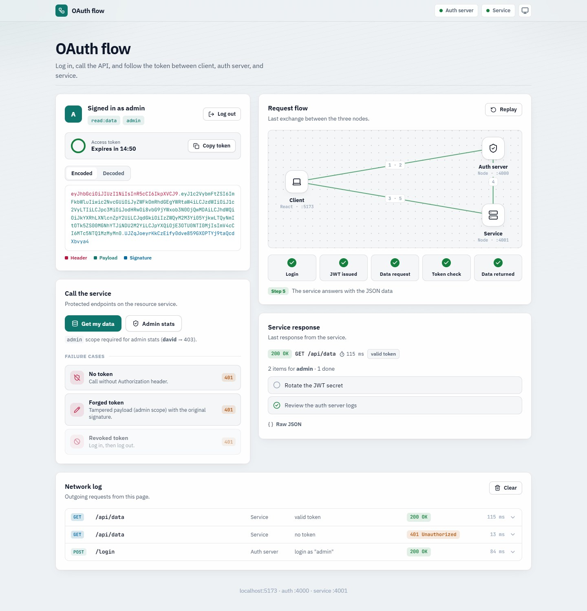
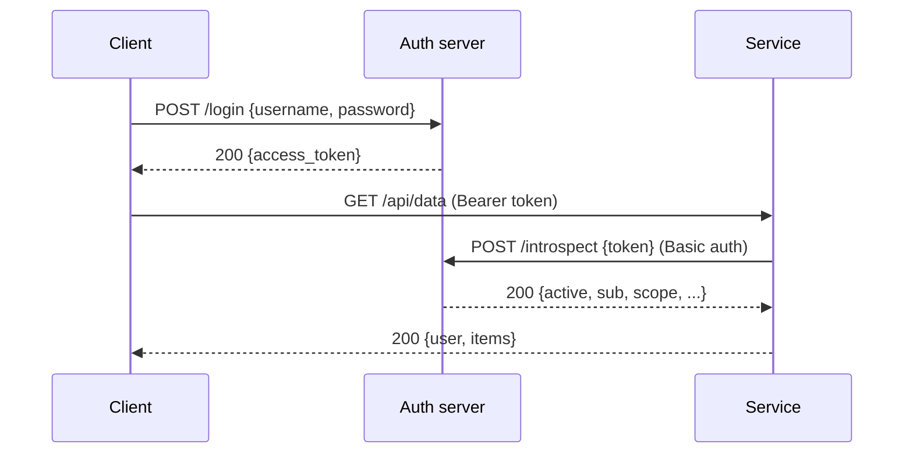

# OAuth Lab

My take on the "Authentication flow with Node" test. It's a simulated OAuth flow with three small TypeScript apps:

- `auth-server/` (Express 5 + jose): logs users in, gives out JWTs and answers token introspection.
- `service/` (Express 5): the resource server. It doesn't validate the JWT by itself, it asks the auth server.
- `client/` (React 19 + Vite): a UI to run the flow and see every request.

`shared/` has the HTTP helpers that both servers use.

```bash
npm install
npm run dev        # or: docker compose up --build
```

Client on :5173, auth server on :4000, service on :4001. Demo users are `david` (`read:data`) and `admin` (`read:data admin`), and the login form fills them in for you.

**Live demo:** https://oauth-lab-demo.onrender.com. It runs on Render's free plan (from [`render.yaml`](render.yaml)), so the first load can take about a minute while the servers wake up.



Besides the normal calls, the UI has buttons for the failure cases: no token, a forged token (payload changed to add `admin`, original signature) and a revoked token (reused after logout).

## Flow



## Status codes

The test asks for sensible status codes, so this is what each case returns.

**Auth server**

| Route              | Case                                  | Status                                  |
| ------------------ | ------------------------------------- | --------------------------------------- |
| `POST /login`      | OK                                    | `200` + token, `expires_in`, `scope`    |
|                    | Missing field or bad JSON             | `400 invalid_request`                   |
|                    | Wrong user or wrong password          | `401 invalid_credentials`               |
|                    | 5 failed attempts in 60 s from one IP | `429 too_many_requests` + `Retry-After` |
| `POST /introspect` | No valid client credentials           | `401 invalid_client`                    |
|                    | No `token` in the body                | `400 invalid_request`                   |
|                    | Active token                          | `200 { active: true, ...claims }`       |
|                    | Expired, forged or revoked token      | `200 { active: false }`                 |
| `POST /logout`     | Valid token                           | `204`                                   |
|                    | Missing or invalid token              | `401 invalid_token`                     |

Bodies over 10 kB get `413`, unknown routes get `404`.

**Service** (`/api/data` needs `read:data`, `/api/admin/stats` needs `admin`)

| Case                                   | Status                                        |
| -------------------------------------- | --------------------------------------------- |
| Valid token with the right scope       | `200`                                         |
| No `Authorization` header              | `401 missing_token`                           |
| Header isn't `Bearer <token>`          | `400 invalid_request`                         |
| Token not active                       | `401 invalid_token`                           |
| Token OK, scope missing                | `403 insufficient_scope`                      |
| Auth server down or too slow           | `503 auth_server_unavailable` + `Retry-After` |
| Auth server sends something unexpected | `502 auth_server_error`                       |

Errors always look like `{ "error": "...", "message": "..." }`, and the service adds `WWW-Authenticate` like RFC 6750 says.

## Some decisions

- The service could check the JWT signature itself, and it would be faster. I used introspection because then logout really works: a revoked token is rejected straight away, not 15 minutes later.
- `/introspect` answers `200 { active: false }` for a bad token, as RFC 7662 says. The request is fine, the token isn't. The service is the one that turns that into a 401.
- Only the service can call `/introspect`, because it needs HTTP Basic client credentials. CORS is also off for that route.
- A wrong username and a wrong password get the same 401 and take about the same time, because unknown users are checked against a dummy scrypt hash. So the login can't be used to find out which users exist.
- Every token has a `jti`. Logout puts it in a revoke list, and the list drops each entry once that token would have expired anyway.
- The login limit counts failures per IP. By default `X-Forwarded-For` is ignored, so nobody can skip the limit by sending a fake one. Behind a proxy, `TRUST_PROXY` is the number of proxies to trust (it's `2` on Render, because of Cloudflare and Render's load balancer).
- The client keeps the token in memory only, not in `localStorage`. A reload logs you out, which I think is fine here.
- In Docker each server is one esbuild bundle running as a non-root user, so the images don't need `node_modules`.
